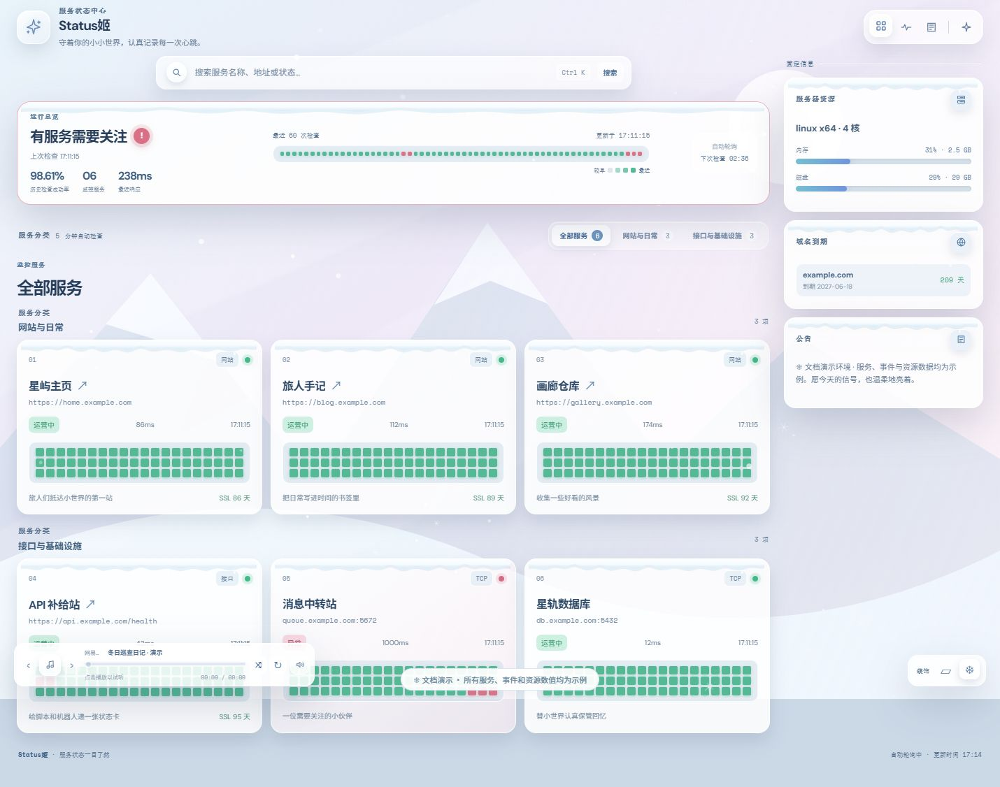
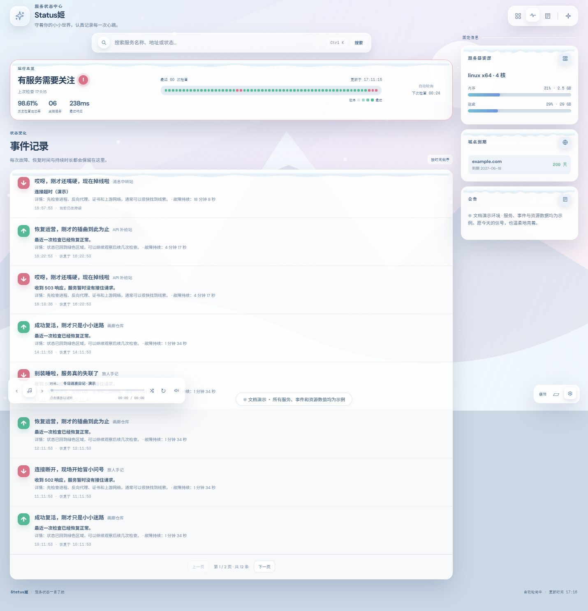
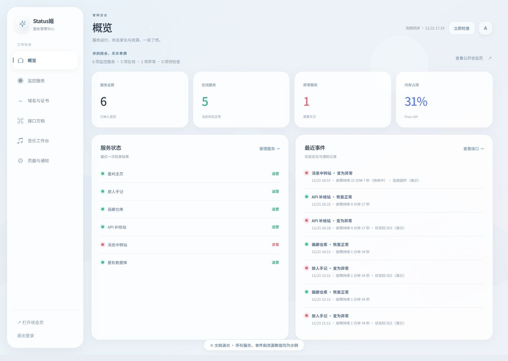
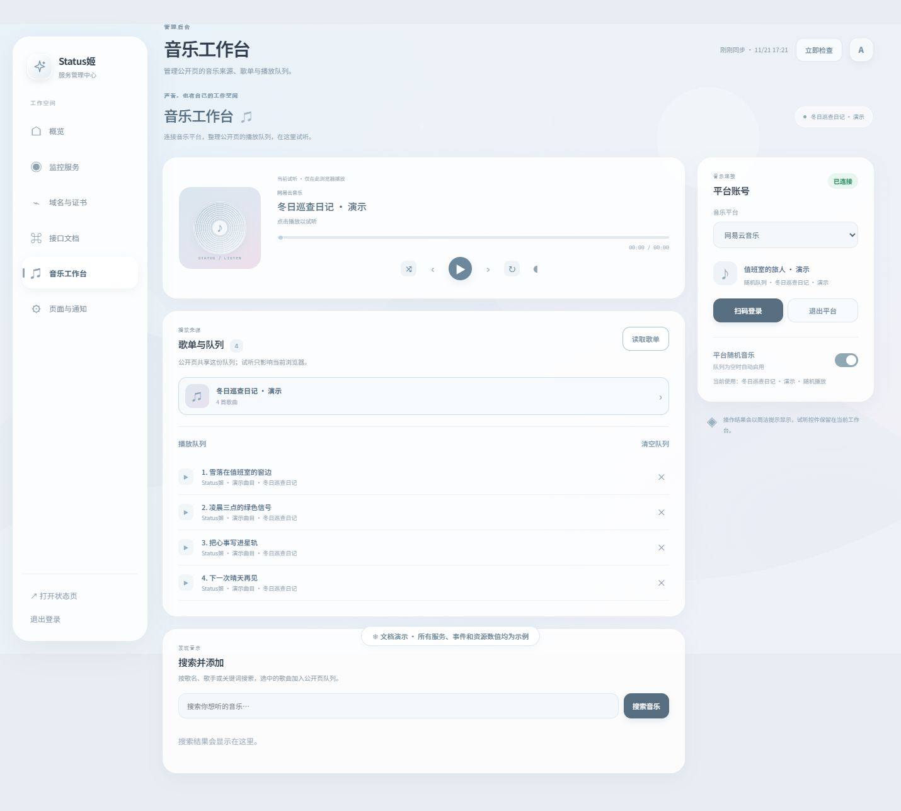
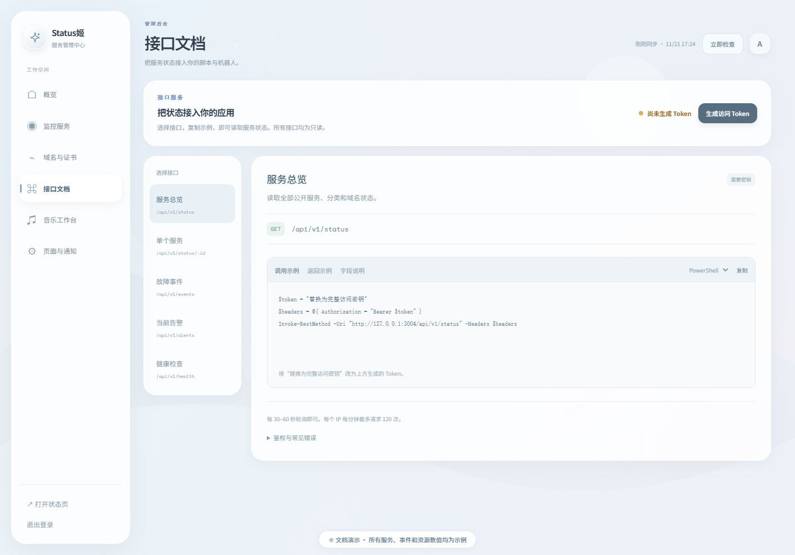

<div align="center">

# ❄️ Status姬

**把服务器的小情绪，交给值班少女。**

轻量、自部署的服务监控与状态页 · v1.0.1

[](https://github.com/futao-awa/Status-Girl/tree/v1.0.1)
[](LICENSE)
[](https://nodejs.org/)
[](https://github.com/futao-awa/Status-Girl/actions/workflows/test.yml)

[认识她](#-初次见面请多指教) · [画廊](#-值班室的小相册) · [开始部署](#-让她开始值班) · [使用文档](docs/DEPLOYMENT.md) · [反馈问题](https://github.com/futao-awa/Status-Girl/issues)

</div>

## 🌸 初次见面，请多指教

服务器上的小世界越来越热闹：首页、接口、数据库，还有总要记着续期的域名和证书。Status姬会按设定的间隔去敲敲门，把服务状态、响应耗时和故障记录整理到一张清清爽爽的状态页上。

她的值班室有玻璃卡片、飘雪、随机壁纸，也可以放一点音乐。适合个人服务器、小型团队，或想给自己的项目们安一个温柔看板的你。



> 本页截图来自独立演示环境，服务、地址、资源数值与事件均为示例；实际部署只展示真实检查记录，没有记录时显示等待检查。

## ✨ 她会帮你记住这些事

- **今天大家都好吗？** 检查 HTTP / HTTPS、API 和 TCP 服务，记录响应耗时与历史成功率；支持期望状态码、响应文本、请求头和超时设置。
- **刚才发生了什么？** 按页查看故障与恢复，记录每次故障的开始、恢复和持续时长；尚未恢复的事件继续计时。
- **下次什么时候巡查？** 倒计时跟随服务器上的真实轮询计划，检查完成后自动更新，刷新页面也不会重新计时。
- **续期的小纸条。** 查看 SSL 证书有效期，手动登记域名到期日，通过 SMTP 邮件或 Webhook 接收提醒。
- **值班室也要好看。** 随机或固定背景图、模糊度和玻璃透明度可在后台调整；落雪与纸张装饰随心切换。
- **听点歌再继续吧。** 网易云 / 汽水音乐扫码连接、歌单与随机来源、逐首管理队列；前台支持暂停、切歌、拖动进度、随机和循环播放。
- **给机器人递一张状态卡。** 后台生成只读 Token，让脚本、QQBot 或其他工具读取状态、事件与告警。
- **按喜欢的顺序排好队。** 后台按分类查看服务并拖动排序；手机上长按分类行再拖动，公开页也会跟着调整。
- **有新消息时敲敲门。** 后台会提醒 GitHub 新版本和更新内容，可以去看看，也可以稍后提醒或忽略这一版。

原生前端 + Node.js / Express，数据保存在本地 JSON 文件里，无需单独安装数据库，也没有前端打包步骤。

## 📷 值班室的小相册

<details>
<summary>展开看看：故障事件与持续时长</summary>



每一次短暂掉线，都有自己的时间线。

</details>

<details>
<summary>展开看看：后台管理与服务列表</summary>



服务、域名、页面设置和通知，都在同一个工作台。

</details>

<details>
<summary>展开看看：音乐工作台</summary>



选好歌单，让值班时间多一点旋律。截图中的曲目仅演示队列布局，不提供音源。

</details>

<details>
<summary>展开看看：简洁的接口说明</summary>



选择一个接口，复制示例；返回内容和字段说明也在手边。

</details>

## 🚀 让她开始值班

准备 **Node.js 22+** 和 npm，建议使用仍受维护的 LTS 版本。

```bash
git clone https://github.com/futao-awa/Status-Girl.git
cd Status-Girl
npm ci
```

复制配置文件：

```bash
# Linux / macOS
cp .env.example .env
```

```powershell
# Windows PowerShell
Copy-Item .env.example .env
```

打开 `.env`，先换好管理员密码与会话密钥：

```dotenv
PORT=3000
NODE_ENV=development
SESSION_SECRET=replace-with-your-own-random-secret
ADMIN_USERNAME=admin
ADMIN_PASSWORD=replace-with-your-own-strong-password
MUSIC_PROVIDER=netease
MUSIC_API_BASE_URL=
```

生成随机会话密钥可用：

```bash
node -e "console.log(require('node:crypto').randomBytes(32).toString('hex'))"
```

```bash
npm start
```

打开 `http://127.0.0.1:3000/` 与 `http://127.0.0.1:3000/admin.html`。首次启动后，去后台添加你的服务，她就开始巡查啦。

**账号密码只在首次创建数据库时从环境变量读取。** 以后请在后台「页面与通知 → 后台安全」修改用户名或密码；调整 `.env` 不会覆盖已有账号。未设置时的本地体验账号为 `admin` / `ChangeMe123!`，首次登录会要求修改密码。

正式部署请设置 `NODE_ENV=production`、使用 HTTPS，并为 `data/` 保留写入权限。宝塔、PM2、反向代理和备份步骤见 [部署指南](docs/DEPLOYMENT.md)。

## 🎵 音乐与外部服务

在后台「音乐工作台」选择平台并扫码连接。歌单为空时默认使用随机来源，也可以自己整理播放队列。`MUSIC_API_BASE_URL` 留空时使用内置直连；有兼容的自建音乐 API 时再填写其地址。

音乐能否播放取决于平台登录、账号权限、地区和上游接口；浏览器也可能要求首次点击后才允许有声播放。后台试听只影响当前浏览器。Status姬不附带歌曲文件，也不绕过平台的播放限制。

随机壁纸、在线字体、天气和音乐需要对应的网络服务；相关服务不可用时，监控轮询仍可独立运行。壁纸地址可以在后台替换为自己的图片源。

## 💌 给机器人递纸条

前往后台「接口文档」生成 Token，即可读取服务状态、单个服务、故障事件和当前告警。健康检查不需要 Token。

```bash
curl -H "Authorization: Bearer YOUR_TOKEN" https://status.example.com/api/v1/status
```

[接入说明](docs/API.md) · [OpenAPI 定义](public/openapi.json)

## 🧩 一起布置这间值班室

欢迎带着截图、复现步骤或新点子来开 Issue，也欢迎提交 PR。开发前先看看 [贡献指南](CONTRIBUTING.md)；报告敏感问题请参阅 [安全说明](SECURITY.md)。

```bash
npm test
```

当前版本为 **1.0.1**，更新记录见 [CHANGELOG](CHANGELOG.md)，版本标签见 [Tags](https://github.com/futao-awa/Status-Girl/tags)。项目采用单实例 JSON 存储；大规模、多节点监控和集群部署暂不在本版本范围内。

## 📜 关于约定

代码与项目文档以 [MIT License](LICENSE) 开源，版权归 © 2026 futao-awa。依赖、外部字体、壁纸和音乐保留各自的许可证与权利归属。

愿你的服务平稳在线，也愿你有空好好休息。Status姬，开始值班。❄️
